# 缩比车载电子电气架构
### Scaled Automotive E/E Architecture

> 三个控制器、一条 CAN 总线、一套分级电源，做的不是"会跑的小车"，
> 是**一台能开、能看、能诊断、能升级、坏了自己会停的缩比车**。

---

## 一、这个项目到底是什么

用一句话说：**把真车的电子电气架构缩小到一个 300×220 mm 的车板上。**

真车里有 VCU（整车控制器）、MCU（电机控制器）、BMS（电池管理），三者挂在 CAN 总线上，出了问题要能安全停机。这个项目把这三个角色分别用 ESP32-S3、STM32F407、STM32F103 实现，再配一套分级电源和一套分层机械结构。

所以它验证的不是"电机能不能转"，而是：

| 场景 | 现象 | 说明什么 |
|---|---|---|
| 拔掉网关 | 200 ms 内限速停车，动力域不重启 | 上层失效，下层能自救 |
| 顶住车轮 3 秒 | RUN 灯常亮，不复位 | 电源塌陷时控制器活着 |
| 电池掉压 12% | 转速仍是 294/300 | 电压前馈进控制环 |
| 窄道相遇 | 两车自行让行 | 分布式路权仲裁 |
| 总线 70% 负载 | 不丢帧 | 有实时性余量 |

**这四个"坏情况"才是这个项目的主题。**

---

## 二、网上做小车 vs 这个项目

网上绝大多数智能小车，功能很多，但结构是"一个单片机直连所有外设"：

| | 网上小车 | 这个项目 |
|---|---|---|
| 架构 | 单 MCU 直连 | 三节点 CAN 分布式 |
| 失效 | 拔了线就瘫 | 分级降级，各自安全停 |
| 电源 | 一块电池直供 | 功率域/逻辑域/保持域分开 |
| 调试 | 串口打印 | candump + UDS 诊断口 |
| 升级 | 重新烧录 | CAN 上 A/B 双区 OTA |
| 扩展 | 加功能改主程序 | 加节点不动别人 |

一句话：**功能是加法，架构是乘法。功能能买，架构不能买。**

---

## 三、系统全貌

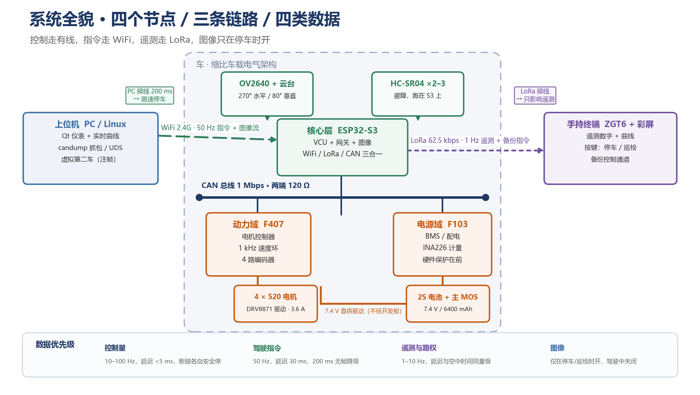

### 3.1 三个控制器

| 节点 | 芯片 | 角色 | 为什么是它 |
|---|---|---|---|
| **核心域** | ESP32-S3-N16R8 | VCU + 网关 + 图像 | 自带 WiFi，16MB Flash / 8MB PSRAM，双核 |
| **动力域** | STM32F407ZGT6 | 电机控制器 | 4 路硬件编码器 + 高级定时器 + FPU，能跑 1 kHz 控制环 |
| **电源域** | STM32F103C8T6 | BMS / 配电 | 上电 <10 ms，安全相关要"快、稳、简单"，不是算力 |

> ESP32-S3 单独当整车核心有三个坑：只有 1 路 TWAI（CAN 2.0B，无 CAN FD）、WiFi 活跃时中断抖动毫秒级会污染 1 kHz 控制、编码器只能靠 PCNT 且占满 4 个单元。
> 所以**双域分离**：F407 管电机与安全，S3 管总线与无线。

### 3.2 三条链路

| 链路 | 用途 | 带宽/延迟 | 断链行为 |
|---|---|---|---|
| **CAN 1 Mbps** | 控制量 | 180 帧/s ≈ 2.3% 负载 | 各自超时各自停 |
| **WiFi** | 驾驶指令 + 图像 | 50 Hz / 20–30 ms | 车 200 ms 限速停车 |
| **LoRa 62.5 kbps** | 车际意图 + 备份指令 | 1 Hz / 20–40 ms | 只影响遥测 |

**控制量永远走有线（CAN），不走无线。**

### 3.3 三个电源域

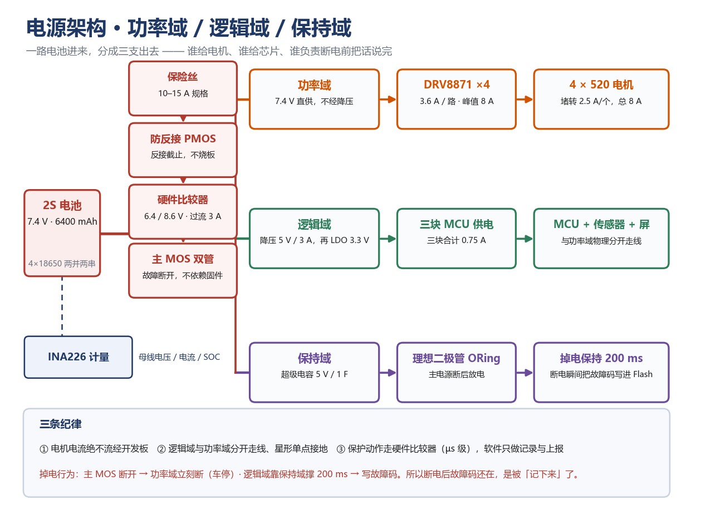

```
2S 电池 7.4V
   │
   ├─ 保险丝 10–15A → 防反接 PMOS → 硬件比较器 → 主 MOS
   │        │
   │        ├─【功率域】7.4V 直供 DRV8871×4 → 4×520 电机
   │        ├─【逻辑域】降压 5V/3A → LDO 3.3V → 三块 MCU
   │        └─【保持域】5V 1F 超级电容 + ORing → 掉电保持 200 ms
   │
   └─ INA226 计量（电压/电流/SOC）
```

**三条纪律：**

1. 电机电流绝不流经开发板（7.4V 直供驱动）
2. 逻辑域与功率域分开走线，星形单点接地
3. 保护动作走硬件比较器（µs 级），软件只做记录与上报

### 3.4 四层机械结构

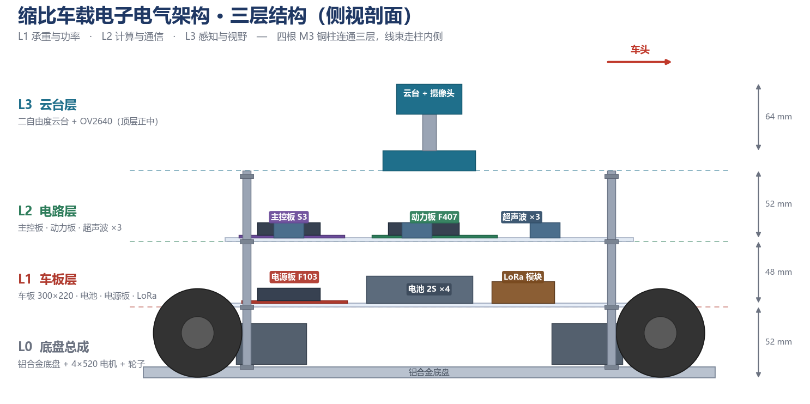

| 层 | 高度 | 放什么 |
|---|---|---|
| L0 底盘 | 0–52 mm | 铝合金底盘、4×520 电机、轮子 |
| L1 车板 | 52–100 mm | 车板、电池、电源板、LoRa 模块 |
| L2 电路 | 100–152 mm | 主控板、动力板、超声波×3 |
| L3 云台 | 152–216 mm | 二自由度云台 + OV2640 |

四根 M3 铜柱连通三层，线束走柱内侧。**是机械分层，不是 PCB 层叠**——每层可以单独拆装。

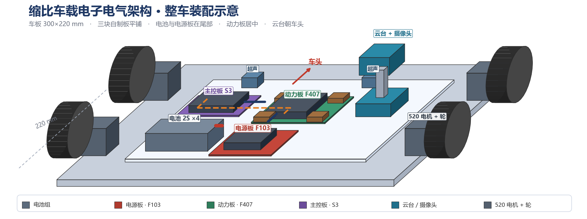

---

## 四、四个分层的内部设计

### 4.1 核心层（ESP32-S3）

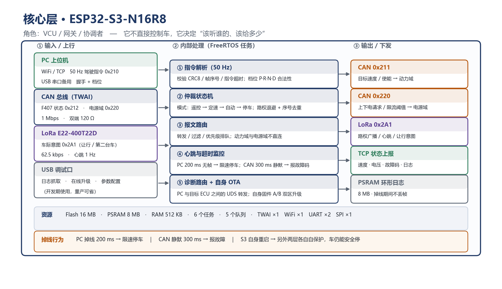

五个 FreeRTOS 任务：

| 任务 | 频率 | 职责 |
|---|---|---|
| 指令解析 | 50 Hz | CRC8 校验、序号检查、档位合法性 |
| 仲裁状态机 | 事件 | 遥控→定速→自动→停车，路权退避 |
| 报文路由 | 事件 | 转发、过滤、优先级排队 |
| 心跳与超时 | 10 Hz | PC 200 ms 无帧→限速停车；CAN 300 ms 静默→报故障 |
| 诊断路由 + 自身 OTA | 事件 | UDS 转发、A/B 双区自升级 |

**核心层的存在理由**：PC 说 TCP、总线说 CAN，中间必须有人翻译；而且摇杆指令不能直接灌进动力域。这就是 T-Box 的活。

两条路径要分清：

```
主控：PC ──WiFi──> S3 ──CAN──> F407
观测：PC ──USB-CAN──> 总线（抓包、注帧、UDS）
```

### 4.2 动力域（F407）

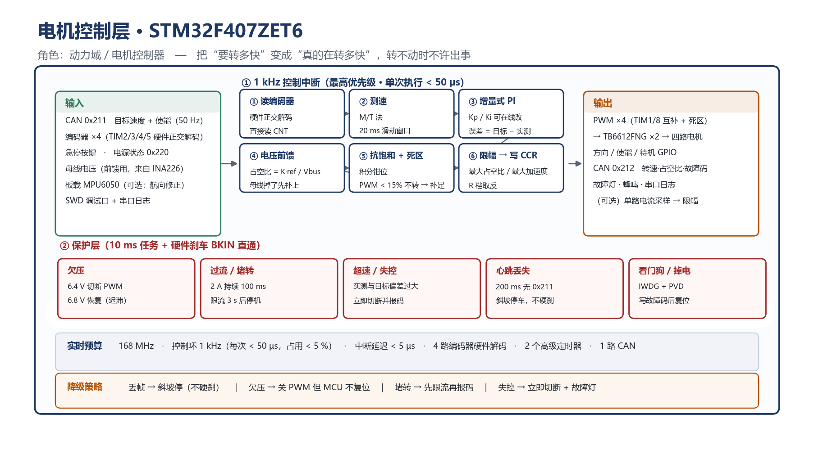

1 kHz 控制中断六步：

```
① 读编码器（TIM2/3/4/5 硬件正交解码）
② 测速（M/T 法，20 ms 滑动窗口）
③ 增量式 PI（Kp/Ki 可在线改）
④ 电压前馈（占空比 = K·ref / Vbus）
⑤ 抗饱和 + 死区补偿（PWM<15% 不转需补足）
⑥ 限幅 → 写 CCR
```

保护层（10 ms 任务 + 硬件刹车 BKIN 直通）：欠压 6.4V 切 / 6.8V 恢复、过流 2A·100ms、超速失控、心跳丢失 200ms 斜坡停车、看门狗 IWDG+PVD。

**实时预算**：168 MHz、1 kHz 每次 <50 µs（占用 <5%）、中断延迟 <5 µs。

### 4.3 电源域（F103）

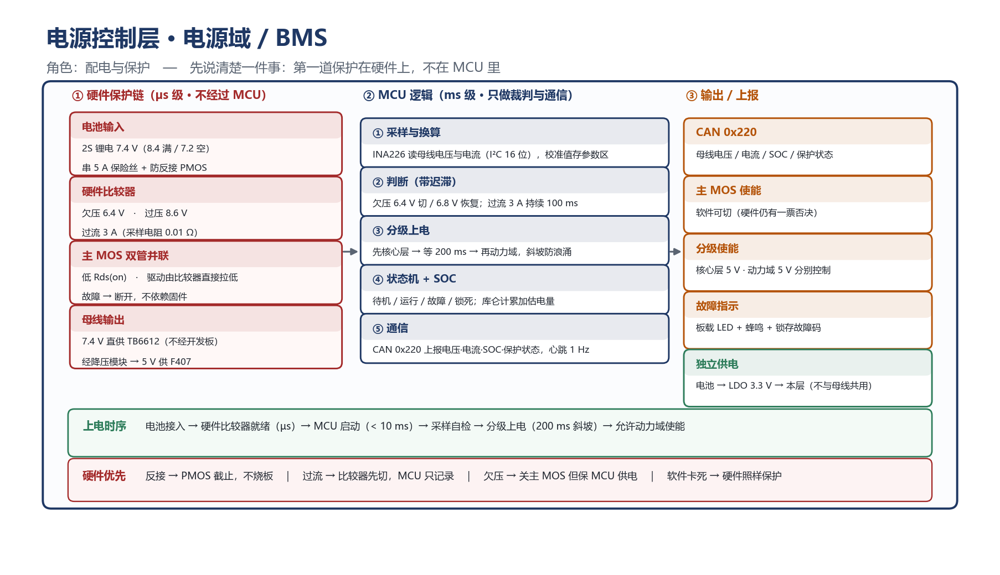

- **硬件保护链**（µs 级）：电池输入 → 硬件比较器 → 主 MOS 双管并联（驱动由比较器直接拉低，故障断开不依赖固件）
- **MCU 逻辑**（ms 级）：INA226 采样 → 带迟滞判断 → 分级上电（先核心层，等 200 ms，再动力域）→ 状态机 + SOC
- **独立供电**：电池 → LDO 3.3V → 本层，不与被保护母线共用

**为什么不用 ESP32 做电源层**：ESP32 从复位到 app 跑起来要 300–500 ms，这是**保护空窗**；F103 上电 <10 ms 就能接管。

### 4.4 上位机（PC / Linux）

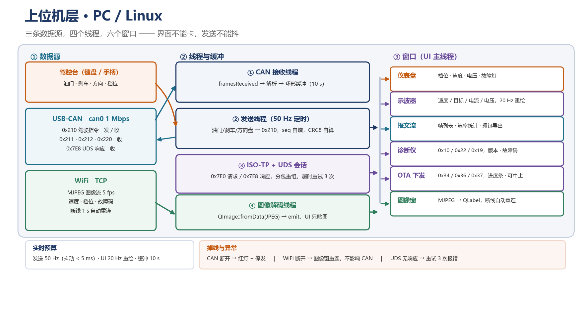

一个程序，六个窗口，四个线程：

| 窗口 | 判据 |
|---|---|
| 仪表盘 | 数值与车上屏幕一致，延迟 <100 ms |
| 示波器 | 100 Hz 数据进、20 Hz 重绘，拖窗口不卡 |
| 报文流 | 帧率统计准确，能导出 pcap |
| 诊断仪 | 能读版本、电压、3 条故障码 |
| OTA 下发 | 10 秒刷完，有进度，可中止 |
| 图像窗 | 5 fps 不卡主线程，拔网线自动重连 |

技术选型：**Qt 5.15/6 + C++ + Qt SerialBus QCanBus + WSL2 Ubuntu + usbipd 透传 USB-CAN**。

三个真难点：**ISO-TP 必须自己实现**（0x22 读版本 17 字节要分包，约 200 行 C++）、50 Hz 发送与 UI 重绘不能互相阻塞、图像解码不能在 UI 线程。

---

## 五、关键设计决策（每条都是踩过坑之后的结论）

### 决策 1：主控是"协调者"，不是"控制器"

核心层下发的是**目标速度 300 mm/s、模式、档位**，不是 PWM 占空比。正因为下发的是"目标"而不是"动作"，下位机才可能自己判断"目标已过期，我该停"。

### 决策 2：等不到消息就停，不是"收到停止命令才停"

这是 fail-safe 的核心。S3 死了 → F407 200 ms 收不到 0x100 → 斜坡停车；F407 死了 → F103 300 ms 收不到 0x200 → 切断动力域 5V。

**关键漏洞及三重兜底**：F407 死了 PWM 会停在最后状态 → 车一直跑。三个解法都做了：

1. 驱动使能脚硬件下拉（DRV8871 的 nSLEEP 下拉到 GND，MCU 死了 GPIO 高阻→自动禁用）
2. F103 兜底切断动力域 5V
3. F407 的 IWDG 复位后靠 ① 禁用

形成"三 MCU 互相看门狗"：S3 看 F407、F103 看 F407、F407 看 S3、硬件看所有人。

### 决策 3：保护在硬件，不在软件

硬件比较器响应 µs 级，软件做不到。MCU 只负责**记录和上报**，不负责**动作**。

### 决策 4：图像不碰 F407

DCMI+DMA 吃总线带宽、软件 JPEG 编码 200–500 ms，会把 1 kHz 控制环拖抖。摄像头接 S3 的 LCD_CAM，**拔掉摄像头车照常开**——这就是域隔离的证据。

### 决策 5：报文按发送方分区

CAN 仲裁 ID 越小优先级越高。按发送方分区（0x1xx=核心层、0x2xx=动力域、0x3xx=电源域、0x4xx=PC）有三个好处：

1. 看 ID 就知道谁发的，故障帧立刻定位
2. 优先级是设计出来的——`0x100` < `0x400`，总线挤时先丢的是"人想怎么开"不是"车该怎么动"
3. 加节点不用重排

| ID | 发送方 | 内容 | 周期 |
|---|---|---|---|
| 0x100 | S3 | 目标速度·使能·档位·模式·CRC8 | 20 ms |
| 0x150 | S3 | 路权意图 | 事件 |
| 0x200 | F407 | 实测转速×4·占空比·状态机·故障码 | 20 ms |
| 0x201 | F407 | 电机电流·温度·里程 | 100 ms |
| 0x300 | F103 | 母线电压·电流·SOC·主 MOS 状态 | 100 ms |
| 0x400 | PC | 油门·刹车·方向盘·档位·seq·CRC8 | 20 ms |
| 0x401 | PC | 云台 pan/tilt/速度/模式 | 100 ms |
| 0x7E0 / 0x7E8 | PC ↔ ECU | UDS 请求 / 响应 | 事件 |

**总线负载**：合计约 180 帧/s，标准帧 8 字节按最坏位填充 130 bit 算，1 Mbps 下占用 **2.3%**。余量极大——所以"70% 负载实验"必须人为灌帧（要 5385 帧/s）。

### 决策 6：分两块板，不是一块大板

```
第 1 版：连线板（三组排母 + CAN + 电源 + 预留功能板插座）
第 2 版：功能板（DRV8871×4 + INA226 + 比较器 + 主 MOS）→ 插到第 1 版上
```

大板打样 ¥100–150、改版整板重做 2 周；小板 ¥30–50、只改问题区、可换子板。**第一版必错是常态，返工风险比稳定性收益更重要。**

### 决策 7：先验证再画板

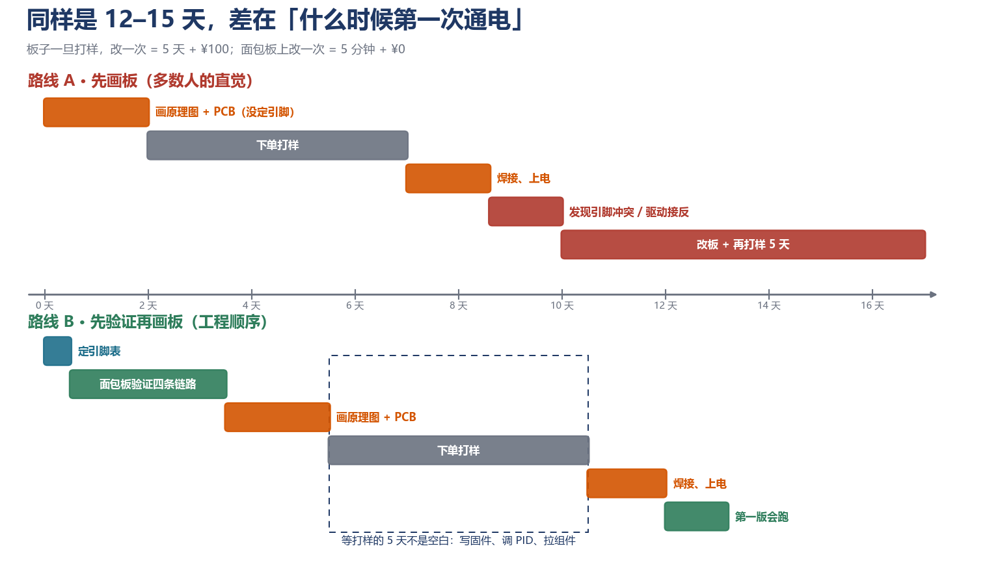

引脚没定死、核心板没到手、四条关键链路（CAN/编码器/驱动/INA226）一次没验证过——**任何一条错都要等 5 天打样才知道**。

正确顺序：定引脚表 0.5 天 → 面包板验证 3 天 → 画原理图 1 天 → PCB 1 天 → 打样 5 天（期间写固件）→ 焊接调试 1.5 天。

**画板不是开始，是把验证过的东西固定下来。**

### 决策 8：保持域用超级电容，不用第二块电池

真车没有两块动力电池，只有"动力电池 + 12V 小电瓶（让 ECU 活着）"。第二块 7.4V 并联需要 ORing 理想二极管、两包电压不等会互充、热切换掉压、演示价值为零。

真正该加的是**保持域**：5V 输出端并 5.5V 1F 法拉电容（储能 0.9 s，只需 200 ms）+ 肖特基。

演示：拔电池 → 屏幕还亮 0.2 s 显示 `FAULT UV 0x05` → 熄灭 → 重上电故障码还在。

---

## 六、失效与降级（三层）

| 层 | 触发条件 | 谁执行 | 动作 |
|---|---|---|---|
| ① 通信降级 | PC / WiFi 断，S3 还活着 | S3 | 超声波测距 + 减速停车 + 云台转向故障方向 |
| ② 主控板失效 | S3 无心跳 | F407 | 斜坡停 + 双闪 + 蜂鸣 + 故障码 |
| ③ 极端失效 | F407 也死 | 纯硬件 | 驱动使能脚下拉、电机断电 |

### 通信降级的动态阈值

```
d_need = v² / (2·a_brake) + v·0.1s + 50mm
```

| 速度 300 mm/s | 减速度 | d_need |
|---|---|---|
| 缓停 | 800 mm/s² | ≈86 mm |
| 快停 | 2000 mm/s² | ≈52 mm |
| 急停 | 2500 mm/s² | ≈48 mm |

**速度越快阈值越大，所以必须每次实时算，不是查表。**

决策（每 20 ms）：`dist < d_need` 或超声波失效 → 急停；`dist < 2·d_need` → 快停；否则缓停。减速过程中持续测距，距离继续缩小则自动升级档位。

### 三个坑

1. **超声波要投票**：盲区 2 cm、可靠 3–4 cm，连续 3 次中 2 次一致才采信。**超时/无效一律视为有障碍 → 急停**（保守）
2. **急停 ≠ PWM=0**：惯性还要滑 10–20 cm，要短接制动（IN1=IN2=1），但必须**先降到 100 mm/s 以下**，否则大电流触发 OCP 烧驱动
3. **恢复后不自动加速**：必须人重新给一次油门（真车叫"故障恢复后要求重新确认"）

### 四个可演示场景

| 场景 | 现象 |
|---|---|
| 拔 WiFi，前方空旷 | 平滑减速约 2 s 停 + 双闪 |
| 拔 WiFi，前方 200 mm 纸箱 | 明显快停，1 s 内 |
| 拔 WiFi，前方 80 mm | 猛地停住（短接制动、车身点头） |
| 拔 WiFi + 手堵超声波 | 立即停（感知失效保守） |

---

## 七、硬件选型

### 三块核心板

| 板 | 型号 | 价格 | 备注 |
|---|---|---|---|
| 动力域 | STM32F407ZGT6 核心板 | ¥47.3 | 144 脚全引出、1MB Flash、8MHz 晶振 |
| 电源域 | STM32F103C8T6 最小板 | ¥14.8 | 64KB/20KB、带 CH340、CH340 占 PA9/PA10 |
| 核心域 | ESP32-S3-N16R8 | 已有 | 16MB Flash + 8MB PSRAM、原生 USB-Serial/JTAG |

### 关键外围

| 器件 | 型号 | 单价 | 为什么 |
|---|---|---|---|
| CAN 收发器 | SN65HVD230 ×3 | ¥5–10 | 3.3V 同电平，不用转换 |
| 电机驱动 | DRV8871 ×4 | ¥5 | 3.6A 峰值，IPROPI 自带电流检测（省采样电阻） |
| 电流计量 | INA226 | ¥10 | ±0.1% 16 位，MCU 内部 ADC 不够 |
| 电机 | 520 减速电机 1:30 ×4 | ¥35 | TT 电机电流太小，「电压塌了速度不掉」演不出来 |
| 主控电容 | 5.5V 1F 法拉电容 | ¥12 | 保持域，掉电写故障码 |

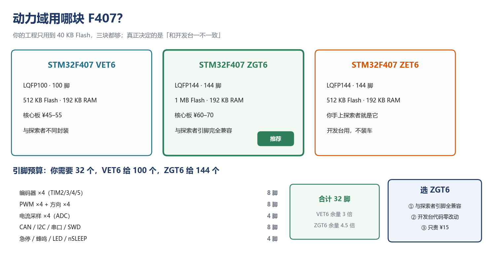

### 硬件硬约束（看图之前必须知道）

从原理图挖出来的：

1. **PA13/PA14（SWD）、PC14/PC15（晶振）不引出到排针** —— SWD 只能用板上的专用接口
2. **3.3V 输出 ≤500 mA** —— 别指望用它给电机或大负载供电
3. **5V 进、板载 RT9193 转 3.3V** —— 推荐 5V 供电，不要 3.3V 直供
4. **407 核心板无板载 USB 转串口** —— 要 USB-TTL 模块
5. **F103 的 CH340 占 PA9/PA10** —— 排引脚时要避开

### 已知引脚冲突（画板前必须解决）

| 冲突 | 涉及 | 解法 |
|---|---|---|
| TIM2/TIM5 抢 PA0/PA1 | 编码器 ×2 | 重映射到 PA15/PB3 + 关 JTAG |
| TIM1_CH2/CH3 抢 USART1 | PWM vs 串口 | PWM 全用 TIM8（PC6–PC9） |
| I2C1 抢 TIM4 | INA226 vs 编码器 | INA226 走 I2C2（PB10/PB11） |

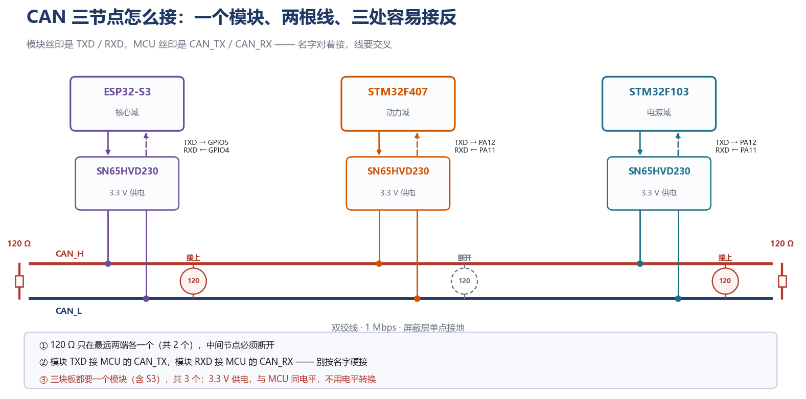

---

## 八、功能清单

### P0（不做完不算项目完成）

| 编号 | 功能 | 出口判据 |
|---|---|---|
| F0 | 线控驾驶（油门/刹车/方向盘/档位） | 摇杆能把车开走，端到端 <50 ms |
| F1 | CAN 三节点打通 | 连续 10 分钟零错帧 |
| F2 | 速度闭环 | 稳态误差 <5% |
| F3 | 四轮 + 电压前馈 | 电压降 12%，转速漂移 <2% |
| F4 | 分级上电 + 欠压保护 | 顶住车轮 3 秒，不复位 |
| F5 | 三层降级 | 拔网关 200 ms 停车，F407 不重启 |
| F6 | 上位机仪表 + 抓包 | candump 能抓全，曲线实时 |

### P1（应该有）

| 编号 | 功能 | 说明 |
|---|---|---|
| F9 | 通信降级停车 | 动态阈值 + 三级减速度 |
| F13 | CAN 上 A/B 双区 OTA | UDS 0x34/0x36/0x37，10 秒内刷完 |
| F14 | 智能功能（避障） | 跑在 S3 上，动力域固件一行不改 |
| F15 | 感知链（云台 + 摄像头） | 图像只在停车/巡检时开 |

### P2（有余力再说）

巡线、MPU6050 航向、真第二台车、自动泊车、视觉 SLAM。

### 明确不做

不做 FOC、不做 AUTOSAR、不做功能安全（ISO 26262）、不做 CAN FD、不做 1080p 视频。

---

## 九、当前进度

### 已完成 ✅

| 项 | 产出 |
|---|---|
| 需求定义 v1.0 | `01_项目需求定义_v1.0.md`（575 行） |
| 能力地图 | `02_能力地图.md`（PID/CAN/电源/Linux 各章节 + 诚实边界） |
| 现象即证据 | `03_现象即证据.md`（六个演示动作 + 面试台词 + 翻车预案） |
| 采购清单 | `04_采购清单.md`（四部分，P0 ≈¥1,070） |
| 分层设计图 | 核心/电机/电源/上位机 四张 |
| 结构图 | 全貌 / 三层剖面 / 俯视布局 / 装配轴测 |
| 演示动画 | `demo.gif`（四个坏情况）、`layout.gif`（装配过程） |
| ESP32 环境 | ESP-IDF v6.1 + VSCode 插件 + 冒烟测试通过 |
| S3 上电验证 | COM17、PSRAM 8MB、TWAI 1Mbps 启动成功 |
| S3 bringup 固件 | `firmware/00_s3_bringup`（五项自检） |
| ESP32 教程 | `firmware/ESP32-S3_学习教程.md`（15 章） |

### 进行中 🔄

- 采购下单（三块核心板 + CAN 模块 + 面包板验证套装）

### 未开始 ⬜

- F407 动力域固件（1 kHz 速度环）
- F103 电源域固件
- 上位机 Qt 程序
- 连线板 PCB
- 三层机械结构

---

## 十、目录说明

```
Second_Project_Demo/
├── README.md                        ← 本文件（项目解释手册）
├── 项目前期计划制定/
│   ├── 01_项目需求定义_v1.0.md      ← 需求与设计（主文档，575 行）
│   ├── 02_能力地图.md               ← PID/CAN/电源/Linux 要会什么
│   ├── 03_现象即证据.md             ← 六个演示动作 + 台词 + 翻车预案
│   ├── 04_采购清单.md               ← 四部分清单 + 分批下单
│   ├── architecture.png             ← 概念图
│   ├── system_overview.png          ← 系统全貌
│   ├── flow.png                     ← 项目线性流程（10 阶段）
│   ├── demo.gif                     ← 四个坏情况演示动画
│   ├── 核心控制层/layer_core.png    ← S3 内部设计
│   ├── 电机控制层/layer_motor.png   ← F407 内部设计
│   ├── 电源控制层/                  ← power_tree.png + layer_power.png
│   ├── 上位机层/layer_host.png      ← PC 软件设计
│   └── 布局/                        ← car_section / car_model / layout
└── firmware/
    ├── README.md                    ← 固件说明 + 编译命令 + 踩过的坑
    ├── ESP32-S3_学习教程.md         ← 15 章教程
    ├── 00_s3_bringup/               ← S3 自检工程（五项）
    └── 01_s3_query/                 ← S3 查询工程
```

---

## 十一、怎么编译（ESP32-S3）

环境：Windows + ESP-IDF v6.1 + Python 3.13 venv

```bash
# 编译
python _build_bringup.py "路径\00_s3_bringup" build

# 编译 + 烧录
python _build_bringup.py "路径\00_s3_bringup" flash

# 看日志
python _serial_read.py COM17 15
```

⚠️ **必须用 PowerShell，不能用 Git Bash**（ESP-IDF v6.x 拒绝 MSys）
⚠️ **工程路径不能含中文**（GCC 会把中文截断成 `\x0a`，报 `cannot read spec file`）

### 已经踩过的三个坑（`sdkconfig.defaults` 里已预置解法）

| 现象 | 原因 | 解法 |
|---|---|---|
| `internal compiler error: Segmentation fault` | GCC 15.2 在 `-Og` 崩 | `CONFIG_COMPILER_OPTIMIZATION_PERF=y` |
| `Private include directory ... esp_wifi` 报 error | 组件路径警告被当错 | `CONFIG_COMPILER_DISABLE_DEFAULT_ERRORS=y` |
| 日志警告 `GPIO 44 and 43 are used as console UART` | 默认控制台占脚 | 画板避开 GPIO43/44 |

---

## 十二、已知风险与待确认

| 项 | 状态 | 影响 |
|---|---|---|
| F407 核心板是否 144 脚全引出 | 待实物核对 | 影响引脚分配表 |
| F103 资料是 ZE 核心板，买的是 C8T6 最小板 | 已确认不匹配 | 只能当参考设计 |
| 三块板的排针间距 | F407 ≈43.5mm 待实测、S3 25.4mm 已确认、F103 待实测 | 影响连线板 |
| 电机 TT 还是 520 | 推荐 520 + DRV8871 | 影响电流预算与演示效果 |
| 底盘 30×22 cm 是否接受 | 待确认 | 影响布局 |
| ESP32-S3 上 WiFi + 图像 + CAN 同时跑 | 有真实风险（约 90% 负载） | 手机控车与摄像头不能同时开 |

---

## 十三、为什么这个项目值得写进简历

不是"我做了个小车"，而是：

> **我设计并实现了一套缩比车载电子电气架构：三节点 CAN 分布式控制、三级电源域（功率/逻辑/保持）、三层失效降级、CAN 上 A/B 双区 OTA。核心验证点是四个坏情况的表现。**

能讲清楚的技术点：

- CAN 2.0B 报文设计（按发送方分区 + CRC8 + 序号）
- FreeRTOS 多任务（双核绑定 + 队列解耦 + 栈水位调优）
- 直流电机速度闭环（编码器 M/T 测速 + 增量式 PI + 母线电压前馈 + 抗饱和 + 死区）
- 电源管理（INA226 计量 + 硬件比较器保护 + 分级上电 + 掉电保持）
- UDS 子集（0x10/0x22/0x34/0x36/0x37）+ ISO-TP 分包
- 故障诊断（故障码 + 心跳超时 + 环形日志）
- 上位机（Qt + SocketCAN + 实时曲线 + MJPEG）

**诚实边界**：没做电流环、没做 FOC、没做 AUTOSAR、没做功能安全——这些要说清楚，说了反而加分。

---

*文档版本 v1.0 · 2026-11*
